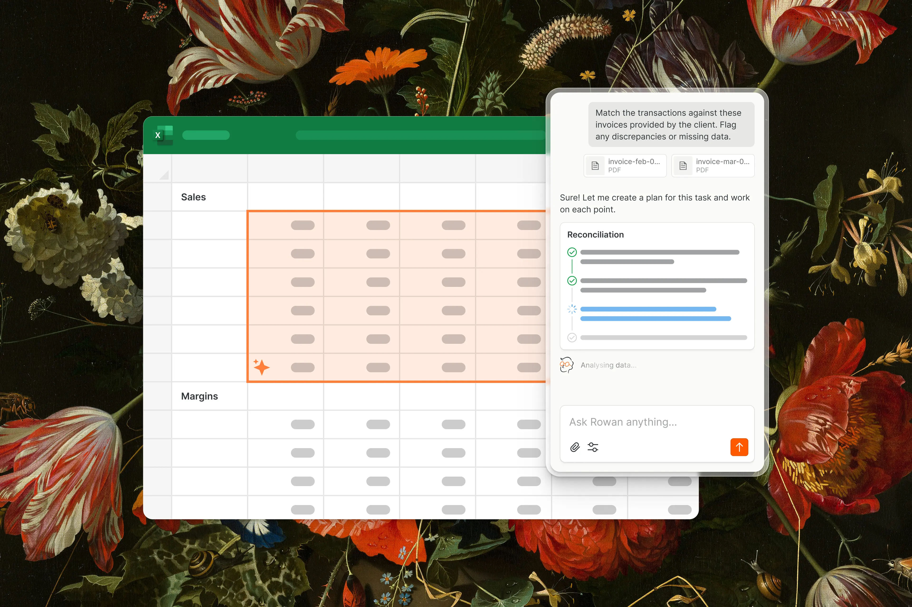
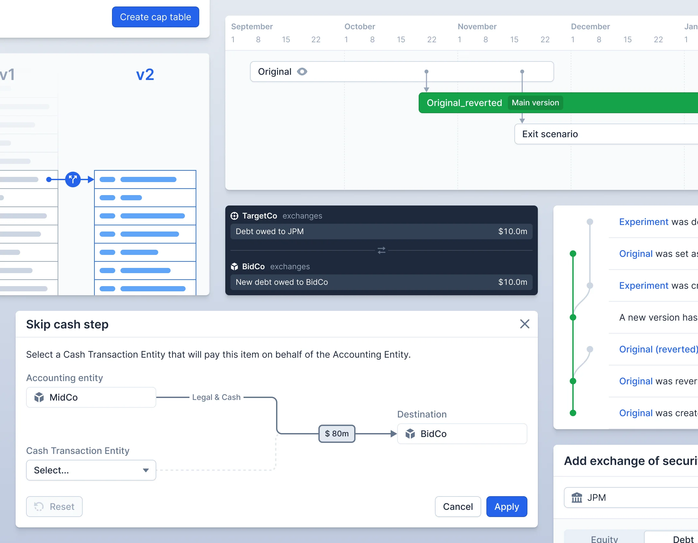
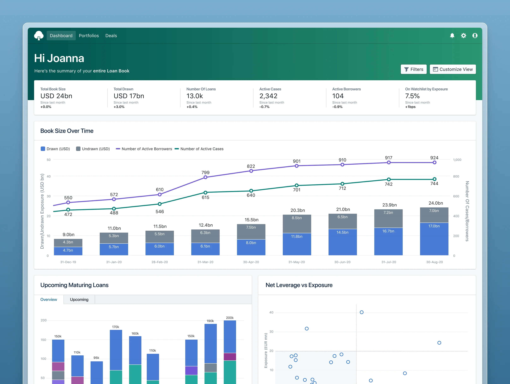

This **demo post** reuses assets already in the portfolio. It gives you a few different image shapes and a video without depending on external image services.

## A plain Markdown image

This image uses ordinary Markdown syntax. Check the space above and below it, and how it fits within the reading column.

## An image with a caption

<figure>
  
  <figcaption>A sample caption beneath a Pactio project image. Captions should feel connected to the image and distinct from the article text.</figcaption>
</figure>

A paragraph after a figure lets you judge where the caption ends and the body copy resumes. Try making the caption longer to see how it wraps.

## A portrait image

<figure class="note-portrait">
  
  <figcaption>A smaller portrait, centred within the article.</figcaption>
</figure>

## A linked image

The image above links to its project page. Use the keyboard to check that its focus state is visible too.

## Video with native controls

<figure>
  <video controls playsinline preload="metadata" poster="/img/projects/rowan-animation.webp" aria-label="Rowan project animation">
    <source src="/img/projects/rowan-animation-compressed.mp4" type="video/mp4">
    
Your browser does not support this video. <a href="/img/projects/rowan-animation-compressed.mp4">Download the Rowan animation</a>.

  </video>
  <figcaption>A local video with controls and a poster image. It starts when you press play.</figcaption>
</figure>

## Back to words

Media should sit comfortably between paragraphs without interrupting the flow of the article. This final section is here to help check the transition back to text.

Continue with the [code demo](/notes/demo-code/) or return to [all notes](/notes/).
